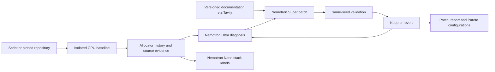
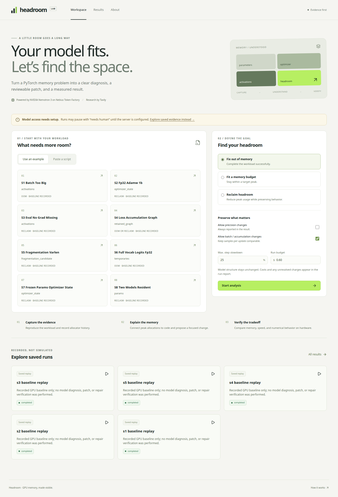

# Headroom

Autoresearch for GPU memory: capture a PyTorch workload, explain its memory use, propose a patch, and measure whether the change works.

**Built with NVIDIA Nemotron 3 (Ultra/Super/Nano) on Nebius Token Factory.** The integration is implemented, and minimal authenticated Super/Nano chats have passed. Ultra capabilities and model-driven repair benchmarks remain pending; see the [bounded probe receipt](reports/tokenfactory-minimal-20261024.json).
**Web research powered by Tavily.** Version-specific search/extraction and cache reuse have been exercised with the real service.

Public demo: pending approved hostname and deployment. Local app: `headroom serve`.
Video: pending a verified repair and the owner's recording.
[Current results](docs/RESULTS.md) · [CLI and project config](docs/CLI.md) · [Task status](PROGRESS.md) · [Original plan](docs/PLAN.md)

## How it works



Each candidate keeps its original baseline, source snapshot, logs and patch. The search makes at most six rounds. A candidate cannot pass by shrinking the model or shortening training. Missing numerical, timing or cost evidence stays unknown. Failed candidates remain inspectable.

| Service | Role | Current evidence |
|---|---|---|
| Token Factory / Nemotron Ultra | Evidence-grounded diagnosis and repair planning | Offline SDK/schema integration; live capability, long-input and cost probes pending |
| Token Factory / Nemotron Super | Bounded patch generation and repair | Minimal authenticated chat passed; diff/apply/compile tested offline; real generated repair pending |
| Token Factory / Nemotron Nano | Top-stack labels with a 0.02 USD sub-budget | Minimal authenticated chat passed; offline labels/budget checks; eight-scenario live agreement pending |
| Tavily | Search plus exact versioned documentation extraction | Real PyTorch 2.5 checkpoint/allocator queries and zero-credit cache hits |

## Quickstart

Run on a Linux NVIDIA/Docker host with Python 3.12, uv, Docker GPU support and sufficient disk. All project assets for this development instance live on azuki.

```bash
git clone https://github.com/xiaodouzi666/headroom.git && cd headroom
uv sync --locked --python 3.12
bash scripts/build_lab_image.sh
cp .env.example .env && chmod 600 .env
uv run headroom fix scenarios/s1_batch_too_big/train.py
```

The host CLI can use uv-managed, Conda, or system Python 3.12. The Lab image owns its Python and hash-locked dependencies; it does not mount the host `.venv`. The build downloads public dependencies into the image using a small retained allowlist context, with no keys or run data. See [Portable Lab runtime](docs/LAB_RUNTIME.md) for disk requirements and image checks.

Without a reviewed live profile, the final command exits 78 and writes a partial report before GPU/model work. Configure the private key, confirmed credit/spending authorization and actual model/pricing/capability evidence using [Runtime setup](docs/RUNTIME.md). The [CPU prompt audit](docs/PROMPT_PREFLIGHT.md) can inspect complete requests without enabling model calls. No payment is initiated by these commands.

For capture-only work, use `uv run headroom snapshot scenarios/s1_batch_too_big/train.py`. To validate the evaluation manifest without executing anything, use `uv run headroom eval --validate-only`; `--dry-run` actually runs all baselines on the GPU and makes no model request.

## App and replay

Build `web/` with Node 24 and `npm ci && npm run build`, then `uv run headroom serve` opens a localhost service on port 8000. It provides example/script submission, a durable event timeline, before/after evidence, diff, verification, Sources and downloads. Public deployment is separate.

Five curated GPU **baseline** replays are available on the development server. They are labeled baseline-only: no diagnosis, patch or repair success is fabricated. Rebuild them from existing captures with `uv run python scripts/curate_baseline_replays.py`. A clean clone has no private run data and therefore no replays until evidence is generated/imported.

Earlier baseline-only interface capture (before the key was configured; it does not show current account status):



[Baseline-only Run screenshot](docs/media/ui-20261024T025659Z-baseline-only/baseline-run-s1-desktop.png) · [Measured UI validation](reports/lighthouse-20261024.json)

## Results and limitations

[RESULTS](docs/RESULTS.md) separates measured baselines, component tests and pending model-driven repairs. No repair success rate or ablation win is claimed yet. The original s2 optimizer-state gate remains failed: 39.8715% versus 40%. Its baseline also already fits 22 GB; the required two-round repair gate is unresolved.

The Lab executes watched commands only in Docker with no network, read-only source/dependencies, bounded resources and verified cleanup. Static policy is defense in depth, not proof that arbitrary hostile programs are safe. Watch observes Python scripts/modules, `-c`, interpreter options and generic argv, including an explicitly requested container shell, while preserving command arguments and exit codes. Automatic repair needs a replayable Python script; other CUDA OOM entrypoints return `needs_human`, and missing instrumentation is reported as unknown. Distributed captures are not aggregate memory evidence. The independent subprocess comparison is blocked by current user/network namespace permissions; see [Watch and HF](docs/WATCH_HF.md). Captures of shared GPUs cannot establish a speed improvement. Random-initialized repository/library fixtures are not evidence of downstream task quality.

## Related work

Headroom combines runtime allocator evidence, reviewable script patches, same-seed verification and a memory-budget search. These components have substantial prior work. The comparison below describes documented scope, not a measured superiority claim. Headroom's model-driven repair evaluation is still pending.

| Prior work | Documented scope | Headroom's intended focus |
|---|---|---|
| [PyTorch memory snapshots and memory_viz](https://docs.pytorch.org/docs/2.14/torch_cuda_memory.html) | Allocator histories, allocation stacks and interactive memory inspection. | Use that evidence to drive a recorded diagnosis, patch and verification loop. |
| [Memory debugging guides](https://pytorch.org/blog/understanding-gpu-memory-1/) and agent skills | Explain debugging techniques or encode reusable procedures; capabilities vary by guide/skill. | Produce concrete patches and measured per-run evidence, with missing verification kept unknown. |
| [GPU-Boost](https://github.com/its-arnavtech/GPU-Boost) | GPU inspection, synthetic benchmarks, source analysis and reviewable patches. Its current README also documents approved deterministic edits, validation and rollback. | Runtime allocator evidence and explicit memory targets; GPU-Boost should not be described as having no execution or validation. |
| [NeMo Megatron-Bridge memory-snapshot skill](https://docs.nvidia.com/nemo/megatron-bridge/nightly/skills/nemo-mbridge-memory-snapshot-analysis/SKILL.html) | Capture guidance and scripts that replay traces, attribute allocations and compare snapshots. | Carry evidence into a script-level repair loop outside a single training framework, within supported Lab entrypoints. |
| [loadtune](https://pypi.org/project/loadtune/) | Empirical ML pipeline profiling and system-parameter tuning, including DataLoader settings, automatic batch sizing and CUDA OOM handling. | Explain allocator-level memory causes and propose source/environment changes, alongside throughput measurements. |
| [AutoKernel](https://github.com/RightNow-AI/autokernel) | Iteratively edits and benchmarks Triton/CUDA kernels, keeping or reverting changes with correctness checks. | Search workload memory changes under numerical and throughput constraints. |
| [Karpathy autoresearch](https://github.com/karpathy/autoresearch) | Iterates on a training program using fixed-duration experiments and validation bits per byte. | Apply a bounded keep/revert search to measured memory use and memory targets. |
| [Checkmate (MLSys 2020)](https://arxiv.org/abs/1910.02653) | Solves tensor rematerialization schedules to trade training time against memory. | Integrate several memory techniques as inspectable patches; no claim of a better scheduling algorithm. |
| [ZeRO-Offload](https://www.deepspeed.ai/tutorials/zero-offload/) | Offloads optimizer state/computation to the CPU through DeepSpeed configuration; supports single-GPU use. | Diagnose a supplied workload and verify suggested changes; offloading itself is established prior work. |
| [Mist](https://github.com/CentML/Mist) and [Galvatron](https://github.com/PKU-DAIR/Hetu-Galvatron) | Optimize distributed training configurations across parallelism and memory-related choices. | A single-GPU script repair workflow, rather than a replacement distributed execution system. |

Sources checked on 2026-10-24. This is a scoped comparison, not an exhaustive novelty review: we do not claim to be the first or only memory-oriented optimization agent. The original planning document is preserved unchanged; the current descriptions above reflect verified upstream documentation. nanoGPT and Transformers provide the repository/library fixtures used here. See [Architecture](docs/ARCHITECTURE.md) for implementation boundaries and [Feedback](docs/FEEDBACK.md) for actual provider observations.

## Development

`uv run pytest -q`, `uv run ruff check .`, `uv run ruff format --check .`, and `gitleaks detect --redact` are the backend checks. Frontend checks are `npm test`, `npm run typecheck`, and `npm run build`. Live model or GPU acceptance is never inferred from mocked tests.

[API](docs/API.md) · [Verification](docs/VERIFY.md) · [Search](docs/SEARCH.md) · [Repositories](docs/REPOSITORIES.md) · [Evaluation](docs/EVALUATION.md) · [Deployment](docs/DEPLOYMENT.md)

License: [Apache-2.0](LICENSE). Thanks to PyTorch, nanoGPT, Transformers, Nebius, NVIDIA and Tavily. Third-party libraries retain their respective licenses.
